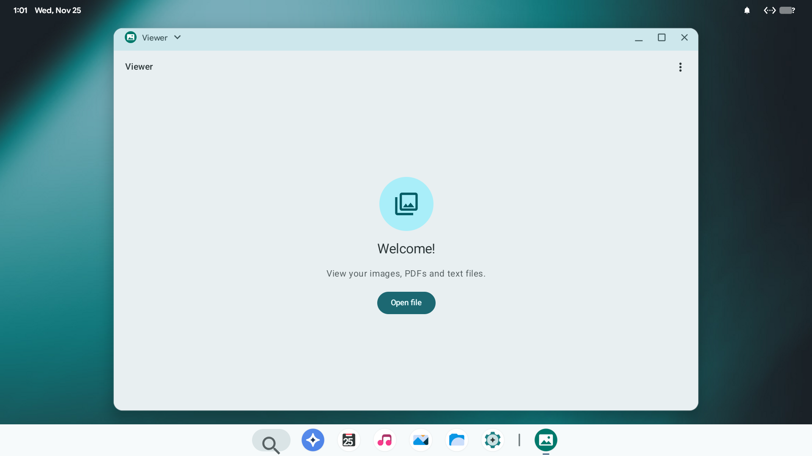

# PcViewer ("Viewer")

Default viewer for images, SVG, PDFs, text, audio and video on LineageOS for PCs (`lineage_pc_x86_64`), the
counterpart of Googlebook's Viewer. A normal (non-privileged) Kotlin + Jetpack Compose + Material 3 app,
package `org.lineageos.pcviewer`.

| Part | Where | What |
|---|---|---|
| `PcViewer` | `src/`, `res/` | the Compose app (`android_app`, `product_specific`, `sdk_version: "current"`) |
| `PcViewerCore` | `core/` | the viewer's logic in plain Kotlin, tested on the host |
| `PcTextEditorCore` | `packages/apps/PcTextEditor/core` | text decoding (encoding and line breaks), shared with the text editor |

## What it does

- **Opens** `VIEW` and `QUICK_VIEW` of `image/*`, `application/pdf`, `text/plain`, `audio/*`, `video/*` and
  `application/ogg`, and `EDIT` of `image/*` (`content` and `file` URIs). Each file gets its own window
  (`documentLaunchMode="intoExisting"`, `taskAffinity=""`). From the launcher it shows a welcome with "Open file".
- **Images** (everything `ImageDecoder` reads): fit on open, never enlarged past actual size; zoom with the bar,
  Ctrl+Plus/Minus, the mouse wheel or a pinch, around the pointer; drag to pan within the image edges; double click
  for fit or actual size; Ctrl+0 fits; rotate the view with Ctrl+R / Ctrl+Shift+R. **Animated** GIF, WebP and
  other sequences play (`AnimatedImageDrawable`). Images over 32 megapixels are decoded subsampled.
- **SVG** is drawn by our own renderer: `core/.../SvgParser.kt` reads paths (all commands, arcs turned into
  cubic curves), rect, circle, ellipse, line, polyline, polygon, groups with transforms, inherited fill and
  stroke with opacity, linear and radial gradients, `<use>`, `<symbol>` and plain `<text>`; `SvgRenderer` draws
  them with `android.graphics`. External DTDs and entities are never read.
- **Edit** (Ctrl+E) for still images and SVG: crop by dragging the box (free, original, square, 16:9, 4:3,
  3:2), rotate, flip horizontally or vertically, brightness and contrast, previewed live. **Save** writes back
  when the format can be written (PNG, JPEG, WebP), **Save as** makes a copy through the picker. Photos are
  decoded again at full quality for saving and keep their **EXIF** data (date, camera, exposure, GPS) through
  androidx ExifInterface, with the orientation reset because the pixels are already turned. Leaving with
  changes asks first. The share sheet's Edit button lands here (see `config_preferredSystemImageEditor`).
- **PDF** through `android.graphics.pdf.PdfRenderer`: pages rendered only while in view, zoom relative to the
  window width (bar, Ctrl+wheel), page indicator. **Password** entry for protected files (`LoadParams`).
  **Find in PDF** (Ctrl+F) across all pages (`Page.searchText`), with highlights, "3 / 12" and previous/next.
  **Links**: web links open in the browser, page links scroll to the page (`getLinkContents`, `getGotoLinks`).
- **Text**: read-only, monospace, selectable, decoded with the editor's detection; "Edit file" hands it to a
  text editor with `ACTION_EDIT`.
- **Audio and video** with `MediaPlayer` and our own controls: play/pause (Space), seek bar with times, back
  and forward 10 s, speed (0.5x to 2x), mute. Playback pauses when the window leaves the screen.
- **Previous / next in the folder**: DocumentsUI's quick view sends the folder's files as clip items with
  `EXTRA_INDEX`. A file opened on its own (plain `VIEW`) finds its folder too: photos, videos and audio through
  MediaStore (same `RELATIVE_PATH`) once the media permission is allowed; other files on shared storage through
  a folder the user allows once (`ACTION_OPEN_DOCUMENT_TREE` started at the file's folder; the grant is kept). A
  banner offers whichever applies. Files are ordered by name, numbers by value.
- **Rename** (F2) through `DocumentsContract.renameDocument` or MediaStore (asking for write consent when the
  file belongs to another app). **Move to trash** (Delete) through the MediaStore trash (kept 30 days);
  files that are not on shared storage can only be deleted, after a question. **Print** (Ctrl+P): images
  through androidx `PrintHelper`, PDFs as they are, text paginated in a monospace font.
- **File info**: name, type, size, date modified, and dimensions, page count or duration.
- Texts in English (`res/values`) and Brazilian Portuguese (`res/values-pt`).

Googlebook's Viewer was used only as a layout reference (welcome screen, top bar actions, round previous/next
buttons, page indicator, editor tools and aspect presets, details fields). No code, images, fonts or icons were
taken from it; the launcher icon is our own vector and the UI icons come from the Material icons library.

## Tests

```sh
core/run_tests.sh                       # 109 JUnit tests of the core, with external/kotlinc and JUnit from prebuilts
python3 -m unittest discover -s tests   # UI strings: both languages, same placeholders, no em dash
tools/typecheck.sh                      # compiles core + PcTextEditorCore + Compose UI against the prebuilts and the public SDK
```

`tools/typecheck.sh` needs `packages/apps/PcTextEditor` in the tree and the coroutines jar of a previous build in
`out/soong/.intermediates`; it builds no APK. In Soong the core tests are `PcViewerCoreTests`.

## Build integration

- `device.mk`: `PRODUCT_PACKAGES += PcViewer PcTextEditor` (the viewer links `PcTextEditorCore`)
- local manifest: `<project path="packages/apps/PcViewer" name="android_packages_apps_PcViewer" remote="pc" revision="lineage-24.0" />`
- framework overlay: `config_preferredSystemImageEditor` =
  `org.lineageos.pcviewer/org.lineageos.pcviewer.MainActivity`. The share sheet (IntentResolver's
  `ImageEditorActionFactory`) resolves `ACTION_EDIT` of the shared image against that component and shows an
  Edit button.
- DocumentsUI overlay: `trusted_quick_viewer_package` = `org.lineageos.pcviewer`, so the file manager opens files
  with quick view and hands over the folder.

## Limits

- Never built with Soong or run on a device: only the host tests and the host typecheck have run.
- Audio and video use the platform's `MediaPlayer`, so only the platform's codecs and containers play.
  `external/exoplayer` exists but its modules are `visibility: ["//packages/providers/MediaProvider:__subpackages__"]`
  (the core one is private), so an app outside MediaProvider can't link it.
- Android refuses folder grants for the storage root and `Download`, so a document there (not a photo, video
  or song) opened on its own has no neighbours; media there are found through MediaStore.
- Edits of images over 32 megapixels are saved at the subsampled size. Animations are not edited (a save
  would keep one frame).
- SVG: clipping, masks, filters, patterns, embedded images and CSS style sheets are not drawn.
- PDF: no text selection, forms or annotations.

## Screenshots

Taken in QEMU/KVM at 1920x1080 from the live ISO.



Viewer before a file is opened.

## License

Apache License 2.0, see [LICENSE](LICENSE). Copyright 2026 Mateus Seiboth. Third-party code keeps its own
license (see Credits).

## Credits

This app is part of LineageOS for PCs and builds on:

- [LineageOS](https://lineageos.org) ([GitHub](https://github.com/LineageOS)): the platform and build tree.
- [The Android Open Source Project](https://source.android.com): the framework (PdfRenderer, ImageDecoder,
  MediaPlayer, MediaStore, DocumentsUI's quick view contract), the Kotlin compiler and the Jetpack Compose and
  AndroidX prebuilts (including ExifInterface and Print).

Thanks to everyone behind these projects. Files taken from them keep their original licenses and copyright notices.
